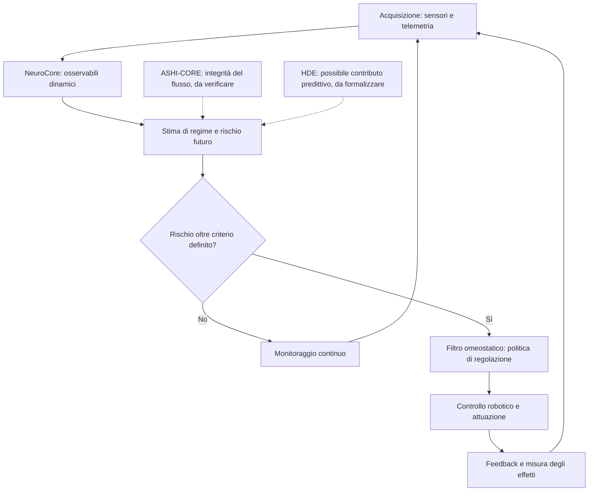

# NEUROCORE

**Independent Research — Neuro-Inspired Computational Architecture, Predictive Homeostatic Control & Robotics**

*Descrizione del progetto e proposta preliminare di ricerca universitaria*

**Autore:** Davide Luca Nicoletti
**Ambito:** Architetture computazionali, sistemi dinamici, telemetria, controllo predittivo e robotica
**Stato:** Ricerca indipendente esplorativa — proposta di validazione sperimentale

---

## PARTE I — DESCRIZIONE E ORIGINE DEL PROGETTO

### 1. Origine e visione

NeuroCore è un progetto indipendente di ricerca concettuale e sviluppo computazionale, originariamente concepito nell'ambito di un simulatore di volo e successivamente evoluto verso l'esplorazione di architetture artificiali ispirate ad alcuni principi funzionali del sistema nervoso umano.

L'intenzione iniziale non era riprodurre biologicamente un cervello, ma tentare di rappresentare alcuni aspetti della sua organizzazione dinamica attraverso modelli computazionali: processi subsoglia, modulazione degli stati interni, transizioni critiche, stabilità, adattamento e possibili meccanismi anticipatori.

Tra i principali riferimenti teorici figura il lavoro del neuroscienziato Karl Friston, in particolare il *Free Energy Principle* e l'*Active Inference*, considerati come fonti di ispirazione per riflettere sulle relazioni tra osservazione, incertezza, stati interni e regolazione del comportamento.

NeuroCore non costituisce una riproduzione delle teorie di Friston, né una loro implementazione formalmente dimostrata. Rappresenta un percorso autonomo di esplorazione di principi funzionali potenzialmente trasferibili a sistemi artificiali.

### 2. Il circuito R e la prospettiva robotica

L'obiettivo progettuale successivo consisteva nel ricondurre queste rappresentazioni a un'architettura implementabile in un circuito, identificato nel percorso di ricerca come **R**, con una prospettiva applicativa rivolta alla robotica.

Il circuito R non rappresenta un cervello biologico, né implica equivalenza neurofisiologica, coscienza artificiale o capacità cognitive umane.

Costituisce invece un possibile supporto fisico per funzioni computazionali di osservazione, analisi delle variazioni dinamiche e regolazione del comportamento di un sistema robotico.

L'ambizione era esplorare un'architettura nella quale la macchina potesse non soltanto reagire a condizioni già manifeste, ma individuare segnali potenzialmente anticipatori di instabilità, utilizzandoli per modificare preventivamente le proprie condizioni operative.

### 3. L'esplorazione EEG e l'ipotesi predittiva

Una fase del percorso ha riguardato l'esplorazione di segnali elettroencefalografici (EEG) e dataset pubblici, utilizzati come possibili ambienti di prova per analizzare variazioni dinamiche e transizioni critiche.

Durante queste attività, l'autore ha richiesto assistenza tecnica per l'interpretazione e la verifica di osservazioni preliminari, comprese ipotesi riguardanti la possibile individuazione di segnali anticipatori di crisi epilettiche, con un orizzonte temporale indicativamente vicino ai venti secondi.

Tale riferimento temporale non costituisce una prestazione predittiva scientificamente accertata. Non sono qui documentate evidenze sufficienti per attribuire al sistema sensibilità, specificità, accuratezza clinica o capacità di previsione affidabile delle crisi.

L'interesse per questo fenomeno aveva una finalità progettuale più ampia.

Le crisi epilettiche venivano considerate come un possibile caso di studio delle transizioni critiche nei sistemi dinamici biologici. L'interrogativo era se determinate configurazioni dei segnali potessero contenere informazioni anticipatorie rispetto a un cambiamento significativo dello stato del sistema.

L'intenzione non era necessariamente sviluppare un dispositivo medico, ma comprendere se un principio astratto di anticipazione potesse essere successivamente adattato alla robotica.

### 4. Dall'anticipazione delle crisi alla prevenzione degli errori

Il passaggio concettuale consisteva nell'esplorare la trasferibilità di una logica generale: riconoscere condizioni potenzialmente critiche prima che producano un evento osservabile.

Nel dominio EEG, l'ipotesi riguardava l'identificazione di possibili precursori di transizioni neurologiche.

Nel dominio robotico, l'obiettivo diventava individuare variazioni sensoriali, informative o operative potenzialmente associate a errori, instabilità o comportamenti indesiderati.

La somiglianza tra i due domini è esclusivamente concettuale: entrambi possono essere studiati attraverso segnali temporali, stati dinamici e possibili transizioni. Non si presume che condividano gli stessi meccanismi fisiologici o le medesime leggi matematiche.

Questo orientamento si collega anche alle riflessioni sviluppate nell'ambito di **HDE**, da considerare come parte del percorso esplorativo relativo a dinamiche e possibili meccanismi anticipatori, senza attribuirgli capacità predittive già dimostrate.

L'analogia con il comportamento umano riguarda la possibilità funzionale di valutare una condizione prima di agire e correggere una decisione potenzialmente errata. Non implica che un robot pensi o comprenda come un essere umano.

### 5. ASHI-CORE: percolazione e integrità dei flussi informativi

Un'altra componente del percorso è rappresentata da **ASHI-CORE**, sviluppato nell'ambito dell'esplorazione di sistemi di telemetria e controllo dei flussi informativi.

In questo contesto, la teoria della percolazione è stata introdotta come riferimento matematico e concettuale per studiare la continuità della propagazione dei dati attraverso una struttura interconnessa.

L'interesse riguardava l'individuazione di possibili falle nel flusso informativo, perdite di connettività, interruzioni o anomalie capaci di compromettere l'integrità della telemetria.

La finalità progettuale era valutare se il superamento di determinate soglie di errore potesse attivare un **filtro omeostatico**, inteso come meccanismo di protezione e regolazione del sistema.

In questa impostazione, il filtro avrebbe il compito di contribuire al mantenimento delle condizioni operative entro limiti definiti, attraverso l'identificazione di anomalie e l'eventuale applicazione di misure correttive.

L'impiego della teoria della percolazione rappresenta una scelta modellistica da verificare, non la dimostrazione di nuove proprietà matematiche o di prestazioni già validate.

### 6. L'intuizione unificante: il filtro omeostatico predittivo

Una successiva rilettura del percorso progettuale ha condotto a una possibile semplificazione dell'architettura complessiva.

NeuroCore, ASHI-CORE e le riflessioni collegate a HDE potrebbero essere interpretati non necessariamente come sistemi da integrare integralmente, ma come differenti contributi concettuali a un problema ingegneristico comune:

**Come può un sistema artificiale riconoscere una condizione potenzialmente destabilizzante e intervenire prima che questa produca un errore operativo?**

Da questa domanda emerge l'ipotesi di concentrare la ricerca su un **filtro omeostatico predittivo**, inteso come nucleo decisionale di un'architettura modulare di monitoraggio e controllo adattivo. **NeuroCore rimane il framework complessivo:** non viene ridotto al solo filtro, poiché acquisizione, analisi dinamica, stima del rischio, decisione e attuazione costituiscono funzioni distinte. Il filtro rappresenta il punto di raccordo fra osservazione e intervento.

Il principio ipotizzato comprende cinque funzioni:

1. Acquisire continuamente informazioni sensoriali e di telemetria.
2. Valutare stati dinamici, anomalie e condizioni di stabilità.
3. Stimare il rischio di una futura transizione indesiderata.
4. Attivare una regolazione preventiva quando il rischio supera criteri definiti.
5. Osservare gli effetti dell'intervento e aggiornare lo stato del sistema.

La differenza rispetto a un semplice filtro a soglia è la presenza ipotizzata di una componente anticipatoria: il sistema non dovrebbe limitarsi a rilevare un errore già presente, ma tentare di riconoscere condizioni che potrebbero precederlo.

Questa impostazione presenta affinità con ambiti ingegneristici già consolidati, quali *predictive control*, *fault detection and diagnosis*, *fault-tolerant control* e sistemi di controllo adattivo.

L'eventuale originalità di NeuroCore dovrà quindi essere valutata nella specifica formulazione, nell'organizzazione degli operatori, nella loro integrazione e nelle prestazioni sperimentali, non nel principio generale della regolazione predittiva.

Il filtro omeostatico predittivo costituisce attualmente una **ipotesi di sintesi progettuale**, non una conclusione scientificamente dimostrata. Gli operatori Phi, Delta e Omega documentati nel kernel possono descrivere proprietà dei segnali, ma non sono per questo predittori validati di errori futuri. Anche una manovra normale può produrre variazioni significative: occorre distinguere perturbazioni innocue da precursori di eventi critici.

### 7. Percorso indipendente e metodologia

NeuroCore e i modelli collegati sono nati da un percorso autonomo di studio, ragionamento concettuale e sperimentazione, al di fuori di programmi accademici specialistici.

L'autore, Davide Luca Nicoletti, ha sviluppato le proprie ipotesi attraverso l'analisi di riferimenti scientifici, l'elaborazione di analogie funzionali e l'esplorazione di possibili applicazioni computazionali.

Strumenti di intelligenza artificiale hanno contribuito, nelle fasi pertinenti, alla formalizzazione, alla programmazione, all'interpretazione preliminare e alla documentazione.

Le intuizioni e gli obiettivi progettuali dichiarati dall'autore devono essere distinti dai contributi tecnici prodotti con assistenza AI e dai risultati che richiedono validazione indipendente.

Il progetto viene presentato senza rivendicare qualifiche accademiche o riconoscimenti scientifici non posseduti.

---

## PARTE II — PROPOSTA PRELIMINARE PER UN CENTRO UNIVERSITARIO

### 8. Titolo della proposta

**Studio sperimentale di NeuroCore come architettura modulare di monitoraggio dinamico e controllo omeostatico predittivo per sistemi robotici autonomi**

*Predictive Homeostatic Regulation Architecture for Autonomous Robotic Systems*

### 9. Obiettivo scientifico

La proposta consiste nel valutare la fattibilità di un'architettura computazionale capace di monitorare continuamente lo stato di un sistema artificiale, riconoscere anomalie e stimare possibili condizioni di instabilità prima che si manifestino come errori operativi.

L'ipotesi centrale è che l'integrazione di osservabili dinamici, indicatori di integrità informativa e criteri di regolazione preventiva possa migliorare, in condizioni sperimentali definite, la capacità di mantenere un sistema robotico entro limiti operativi sicuri.

L'obiettivo non è dimostrare che NeuroCore riproduca il cervello umano, ma verificare se una specifica architettura neuroispirata possa fornire un contributo misurabile rispetto a tecniche di controllo già esistenti.

### 10. Ipotesi di ricerca

**Ipotesi H1 — Rilevamento delle transizioni**

Determinati osservabili computazionali potrebbero contribuire a individuare cambiamenti di regime nei segnali sensoriali e nella telemetria.

**Ipotesi H2 — Integrità informativa**

Un modello di connettività ispirato alla teoria della percolazione potrebbe fornire indicatori utili a riconoscere condizioni di degradazione del flusso informativo.

**Ipotesi H3 — Anticipazione degli errori**

L'analisi temporale degli osservabili potrebbe consentire di stimare alcune condizioni critiche prima che producano un errore operativo, con un anticipo misurabile.

**Ipotesi H4 — Regolazione omeostatica**

L'integrazione delle informazioni precedenti in una logica di controllo potrebbe contribuire a ridurre il tempo trascorso in condizioni instabili o il numero di eventi indesiderati.

**Ipotesi H5 — Trasferibilità computazionale**

Una parte dell'architettura potrebbe essere implementata su hardware embedded compatibile con i vincoli di memoria, latenza e consumo energetico di una piattaforma robotica.

Tutte le ipotesi sono formulate come questioni verificabili e potenzialmente falsificabili.

### 11. Architettura funzionale proposta

**Schema concettuale — architettura proposta, non implementazione robotica validata**

Le linee tratteggiate indicano integrazioni **ipotetiche**, non compatibilità già dimostrata. Il circuito R è una possibile sede fisica di parte delle funzioni, da specificare mediante ingressi, uscite e vincoli hardware. La logica di sicurezza del robot deve rimanere verificabile anche in presenza di previsioni errate.

L'architettura preliminare può essere rappresentata attraverso cinque livelli.

**Livello 1 — Acquisizione**

Raccolta di dati sensoriali e di telemetria, sincronizzazione temporale e identificazione di informazioni mancanti o anomale.

**Livello 2 — Osservazione dinamica**

Calcolo di indicatori di variabilità, entropia, coerenza e cambiamento di regime, includendo, ove pertinenti e verificabili, gli operatori già esplorati nell'ambito NeuroCore.

**Livello 3 — Stima predittiva**

Valutazione del rischio di una futura condizione critica attraverso modelli temporali e criteri di incertezza da definire sperimentalmente.

**Livello 4 — Regolazione omeostatica**

Applicazione di una politica di intervento preventivo, con soglie, priorità e vincoli di sicurezza espliciti.

**Livello 5 — Attuazione e feedback**

Trasmissione dei comandi al sistema controllato, osservazione degli effetti e aggiornamento continuo della valutazione dello stato.

Questa struttura rappresenta un'ipotesi architetturale da sviluppare, non un sistema robotico completo già implementato e validato.

### 12. Piano sperimentale preliminare

**Fase A — Ricostruzione e verifica del materiale esistente**

Analisi delle formulazioni matematiche, del codice e dei documenti disponibili per NeuroCore, ASHI-CORE e HDE.

Identificazione delle componenti effettivamente implementate, delle dipendenze e delle ipotesi ancora prive di formalizzazione.

**Fase B — Esperimenti su telemetria simulata**

Creazione di flussi informativi controllati nei quali introdurre perdita di pacchetti, ritardi, rumore, interruzioni e anomalie progressive.

Valutazione della capacità degli indicatori di riconoscere condizioni di degradazione e distinguere eventi critici da normali fluttuazioni.

**Fase C — Valutazione predittiva**

Verifica della possibilità di anticipare eventi operativi definiti, misurando il tempo di preavviso, la sensibilità, i falsi allarmi e la robustezza rispetto a condizioni non osservate durante lo sviluppo.

**Fase D — Integrazione del filtro omeostatico**

Implementazione di una politica di regolazione preventiva in un robot mobile simulato, sottoposto a perturbazioni riproducibili, e confronto fra tre condizioni: controllo convenzionale a soglia, controllo predittivo standard e NeuroCore con filtro omeostatico. La verifica dovrà includere falsi interventi, ritardo della risposta, stabilità e recupero dopo il disturbo. L'eventuale vantaggio dovrà derivare da misure, non dalla sola presenza di indicatori aggiuntivi.

**Fase E — Prototipazione embedded e robotica**

Eventuale trasferimento su microcontrollore o piattaforma robotica sperimentale, previa verifica delle prestazioni software e dei vincoli di sicurezza.

### 13. Criteri di validazione

**Esperimento prioritario proposto:** un robot mobile in simulazione deve seguire una traiettoria mentre la telemetria subisce ritardi, perdita di pacchetti e rumore. Il confronto verifica se il sistema NeuroCore riduce errori di traiettoria e condizioni instabili rispetto ai riferimenti, senza introdurre interventi superflui. Parametri, dati di test e criteri di successo vanno fissati prima dell'esperimento.

Per l'eventuale uso della percolazione in ASHI-CORE occorre definire esplicitamente nodi, collegamenti, modalità di guasto e misura di connettività; il semplice verificarsi di perdite di pacchetti non basta a dimostrare una transizione di percolazione.

La valutazione dovrebbe includere confronti con metodi di riferimento, quali controlli a soglia, tecniche standard di rilevamento anomalie e, quando appropriato, modelli di controllo predittivo.

Le metriche principali potrebbero comprendere:

- Anticipo temporale rispetto all'evento critico.
- Sensibilità e tasso di falsi allarmi.
- Riduzione degli errori operativi.
- Tempo di recupero dopo una perturbazione.
- Stabilità del sistema controllato.
- Latenza, consumo di memoria e costo computazionale.
- Robustezza su dati e condizioni non utilizzati durante lo sviluppo.

Un risultato negativo o equivalente ai metodi esistenti dovrà essere documentato, poiché costituisce comunque un esito informativo della verifica scientifica.

### 14. Ruolo dei dataset EEG

I dataset EEG possono mantenere un ruolo storico e metodologico nella documentazione di NeuroCore, come parte del percorso che ha motivato l'interesse per l'anticipazione delle transizioni dinamiche.

Non è tuttavia necessario che la validazione iniziale del filtro omeostatico predittivo dipenda da dati neurologici.

Per una proposta universitaria focalizzata sulla robotica, appare più appropriato iniziare da sistemi simulati e flussi di telemetria con eventi critici chiaramente definiti.

Un'eventuale prosecuzione delle analisi EEG richiederebbe un protocollo autonomo, competenze specialistiche e procedure di validazione adeguate, senza attribuire al sistema capacità diagnostiche o cliniche non dimostrate.

### 15. Contributo atteso

Il possibile contributo del progetto non consiste nella scoperta di un nuovo principio generale di omeostasi, ma nella valutazione di una specifica configurazione modulare che riunisca:

- Monitoraggio di regimi dinamici.
- Analisi dell'integrità informativa.
- Stima anticipatoria di condizioni critiche.
- Regolazione preventiva.
- Implementazione su sistemi artificiali con risorse limitate.

L'interesse scientifico dipenderà dalla possibilità di formulare il modello in modo rigoroso, renderlo riproducibile e dimostrare eventuali vantaggi rispetto alle soluzioni esistenti.

### 16. Richiesta di valutazione accademica

La presente proposta viene sottoposta all'attenzione di eventuali gruppi universitari di ricerca nell'ambito dell'automazione, della robotica, dei sistemi dinamici e dell'ingegneria dell'informazione.

L'obiettivo è richiedere una valutazione preliminare della coerenza teorica, della fattibilità computazionale e dell'eventuale interesse sperimentale dell'architettura proposta.

Si auspica, qualora emergano presupposti scientifici sufficienti, la possibilità di definire un protocollo di verifica circoscritto, attraverso il quale valutare in modo indipendente le ipotesi formulate.

La proposta non presuppone l'accettazione delle ipotesi né richiede il riconoscimento preventivo di innovazioni non dimostrate.

### 17. Dichiarazione finale

NeuroCore documenta un percorso indipendente che, partendo da un simulatore di volo, ha progressivamente esplorato modelli neuroispirati, segnali EEG, sistemi dinamici, telemetria e possibili applicazioni robotiche.

La successiva individuazione del **filtro omeostatico predittivo** come possibile nucleo decisionale unificante rappresenta una sintesi progettuale di tale percorso. NeuroCore resta l'architettura modulare complessiva, mentre il filtro è la funzione di regolazione da sviluppare e sottoporre a prova.

L'ambizione originaria di trasferire alcuni principi funzionali del sistema nervoso umano alla robotica viene così ricondotta a un problema ingegneristico più circoscritto, verificabile e potenzialmente implementabile.

**Non costruire un cervello artificiale, ma studiare un sistema capace di riconoscere condizioni potenzialmente critiche, anticipare errori e regolare preventivamente il proprio comportamento.**

Questa costituisce la direzione di ricerca proposta, non un risultato scientifico già acquisito.

---

**Davide Luca Nicoletti**
Independent Conceptual Research

*Human-originated research direction — AI-assisted formalization, computational development and documentation.*

*Preliminary research proposal — Subject to independent scientific evaluation and experimental validation.*