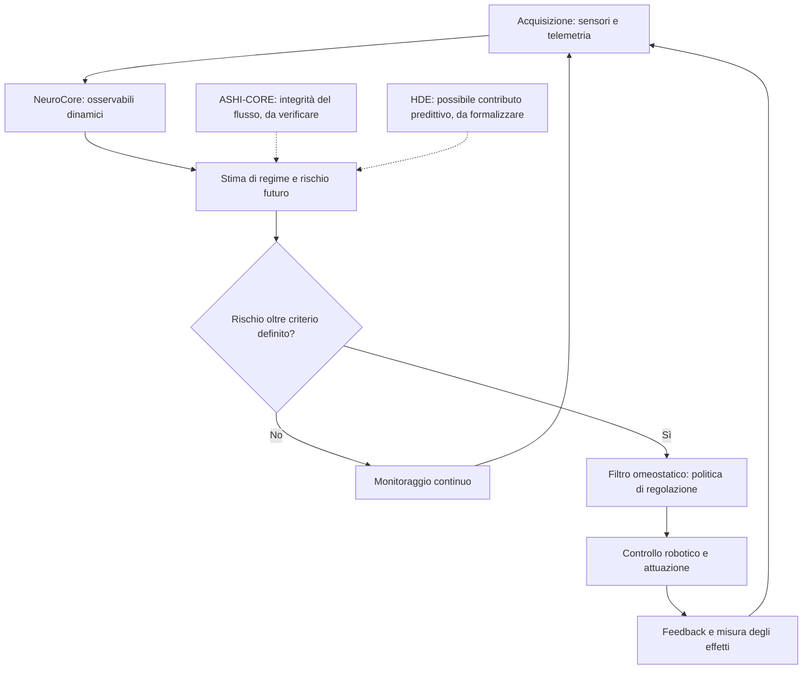

# Toward a Bio-Inspired Framework for Dynamic-State Awareness and Homeostatic Regulation in Hybrid Robotic Systems
NeuroCore is a cross-domain experimental framework designed to investigate whether a common set of mathematical operators can characterize dynamic-state changes and transitions across biological and engineered systems, with the long-term objective of contributing to adaptive, homeostatic regulation in hybrid robotic architectures.

## Research Vision, Experimental Validation, and Long-Term Scientific Development

**Research status:** Early-stage computational research / Experimental proof of concept  
**Primary research domains:** Dynamical systems, robotics, adaptive control, artificial intelligence, homeostatic regulation, resilience monitoring, and predictive diagnostics  
**Initial experimental benchmarks:** NASA C-MAPSS FD001 and FD003  
**Research methodology:** Mathematical modeling, AI-assisted computational experimentation, comparative benchmarking, and progressive empirical validation

---

## 1. Executive Overview — The Purpose of NeuroCore

**NeuroCore is an experimental mathematical and computational framework conceived as a potential component of a future bio-inspired, hybrid robotic control architecture.**

Its long-term ambition extends beyond the detection of mechanical failures or the prediction of equipment degradation.

The central research vision is to investigate whether a computational system can continuously interpret its own internal dynamics, recognize emerging instability, assess changes in operational resilience, and contribute to the regulation of its physical state.

In biological organisms, maintaining viable internal conditions involves coordinated processes of sensing, regulation, adaptation, and feedback. NeuroCore explores whether certain aspects of this general organizational principle can inspire computational mechanisms for engineered systems.

The project is not intended to reproduce the biological brain, establish artificial consciousness, or claim equivalence with biological cognition.

Instead, its ambition is to investigate the foundations of a **bio-inspired dynamic-state monitoring and regulation layer** that could eventually operate alongside established control algorithms, predictive models, and artificial intelligence systems.

In a future robotic implementation, such a layer could potentially contribute to recognizing when a machine remains operational but is progressively losing its ability to maintain stable behavior.

This distinction is central to the research.

A robot may continue executing its assigned movements while its electrical, mechanical, or control subsystems gradually approach an unstable operating regime.

A conventional monitoring system may recognize a problem when a measured variable exceeds a predefined threshold.

NeuroCore investigates whether information contained in the evolving relationships between multiple signals could provide an additional description of the system's changing internal condition.

**The long-term scientific question is therefore not simply whether a robot is functioning, but whether its dynamic organization is becoming increasingly vulnerable to disruption.**

This remains a research hypothesis rather than an experimentally established capability.

---

## 2. The Long-Term Ambition — A Hybrid Robotic Architecture

The broader vision of NeuroCore is to contribute to a future architecture integrating mathematical state monitoring, machine learning, predictive modeling, and conventional control systems.

The concept may be described informally as part of a *robotic brain*, provided that this expression is understood as an engineering metaphor rather than a claim of biological or cognitive equivalence.

A more technically precise description is:

**A bio-inspired supervisory framework for dynamic-state awareness and homeostatic regulation within an AI-assisted robotic control architecture.**

In this proposed architecture, NeuroCore would not necessarily replace established controllers or learning algorithms.

Instead, it would be investigated as a supplementary computational layer capable of processing multivariate sensor dynamics and providing information relevant to the system's operational state.

### 2.1 Proposed Architectural Organization

| Architectural component | Proposed function | Research status |
|---|---|---|
| Physical sensors | Measure electrical, mechanical, thermal, and motion-related variables | Established engineering technology |
| NeuroCore operators | Characterize aspects of temporal variation, changes in dynamic activity, and multivariate organization | Computationally implemented; preliminary testing |
| State estimation | Infer relevant internal operating conditions | Proposed integration |
| AI and predictive models | Estimate risks, future states, or changing operating requirements | Proposed integration |
| Supervisory regulation | Interpret monitoring outputs and determine whether control adaptation is appropriate | Conceptual |
| Conventional control systems | Execute control actions subject to stability and safety constraints | Established engineering technology |
| Physical actuators | Produce mechanical or electrical responses | Established engineering technology |
| Feedback loop | Return new sensor information to the monitoring and control architecture | Proposed system integration |

The envisioned operational sequence is:

**Physical measurements → Dynamic-state interpretation → Predictive assessment → Supervisory decision → Control action → Updated physical measurements.**

The defining research challenge is to determine whether the NeuroCore layer contributes useful information beyond that already provided by conventional state estimators, signal-processing techniques, and predictive models.

Without such evidence, the framework cannot be considered a demonstrated improvement over established control architectures.

### 2.2 Why a Hybrid Architecture?

Modern robotic systems already employ numerous sophisticated techniques for state estimation, adaptive control, fault detection, and predictive maintenance.

NeuroCore is therefore not based on the assumption that these methods are insufficient in general.

The proposed research direction is complementary.

Its mathematical operators may be investigated as additional features or monitoring variables within systems that combine:

- Classical feedback control.
- Statistical state estimation.
- Machine-learning-based prediction.
- Anomaly and change-point detection.
- Supervisory safety mechanisms.
- Adaptive regulation under changing operating conditions.

The objective would be to establish whether these combined mechanisms can improve robustness, disturbance response, early detection of destabilization, or operational continuity.

Such improvements must be demonstrated experimentally.

---

## 3. Scientific Motivation — From Failure Detection to Dynamic Resilience

An important distinction must be made between **detecting an existing fault** and **identifying a system that is approaching a loss of stability or resilience**.

These are related but scientifically different problems.

A system can experience measurable degradation without immediately losing its operational capabilities.

Similarly, a system may undergo a transition between stable and unstable behavior without suffering a conventional mechanical failure.

Examples include:

- An electric motor approaching thermal or current limitations.
- A robotic actuator experiencing increasing oscillations under changing loads.
- A power subsystem approaching a voltage-collapse or protection threshold.
- A feedback controller progressively losing stability margins.
- A robotic mechanism requiring increasingly prolonged recovery after disturbances.

These examples motivate the investigation of dynamic resilience.

In dynamical-systems research, resilience can be associated with a system's ability to withstand disturbances, recover toward an operating regime, or maintain desired behavior under changing conditions.

Relevant established concepts include recovery time, stability margins, autocorrelation, variance, critical slowing down, and early-warning indicators of dynamical transitions.

**NeuroCore does not claim to have discovered these phenomena.**

Its potential scientific contribution would depend on whether its operators provide a useful, reproducible, and demonstrably complementary representation of such behavior.

### 3.1 A Candidate Research Property

One proposed property for future investigation is:

**Early sensitivity to the loss of dynamic resilience in multivariate physical systems.**

This hypothesis asks whether NeuroCore can identify changes associated with reduced resilience before conventional operational thresholds are exceeded.

The hypothesis is experimentally testable, but it has not yet been validated.

### 3.2 Distinguishing Three Research Problems

| Research problem | Central question | Current evidence |
|---|---|---|
| Failure-related pattern detection | Can the operators distinguish healthy from degraded operating conditions? | Preliminary NASA C-MAPSS evidence |
| Early transition detection | Can the operators recognize changes before a documented transition? | Not established |
| Homeostatic regulation | Can NeuroCore improve a closed-loop system's ability to maintain stable operating conditions? | Not yet experimentally demonstrated |

This distinction prevents the results of one experiment from being interpreted as proof of the entire architectural vision.

---

## 4. The Mathematical Operators — Phi, Delta, and Omega

NeuroCore currently investigates three principal mathematical operators:

**Phi (Φ), Delta (Δ), and Omega (Ω).**

The operators are intended to characterize different aspects of evolving system dynamics.

Their functions should not automatically be considered interchangeable.

### 4.1 Operator Roles

| Operator | Investigated interpretation | Potential research role |
|---|---|---|
| Phi (Φ) | Magnitude of temporal activity or variation | Characterization of dynamic change |
| Delta (Δ) | Change in Phi across successive observations | Detection of evolving activity or transitions |
| Omega (Ω) | Combination of phase coherence and entropy-related organization | Investigation of multivariate signal organization |

These descriptions reflect the computational implementations examined in the experiments.

They do not establish that the operators measure universal physical properties.

### 4.2 Experimental Formulations

For the NASA benchmarks, Phi was implemented using logarithmically transformed absolute temporal differences:

\[
\Phi_t = \operatorname{mean}\left(\log(1+|x_{\tau}-x_{\tau-1}|)\right)
\]

Delta was implemented as the absolute difference between successive Phi values:

\[
\Delta_t=|\Phi_t-\Phi_{t-1}|
\]

Omega was implemented as:

\[
\Omega_t=r_t(1-h_t)
\]

where:

- \(r_t\) represents a measure of phase coherence across selected sensor signals.
- \(h_t\) represents normalized entropy derived from the signal distributions within the observation window.

The experimental implementation of phase coherence used Hilbert-transform-based phase estimates.

Entropy was estimated using discretized signal distributions.

These implementation choices are important because the resulting behavior depends on signal selection, preprocessing, window length, sampling characteristics, and normalization.

In particular, phase coherence between heterogeneous physical sensors does not automatically have a direct or established physical interpretation.

The mathematical and physical significance of these relationships requires additional theoretical and experimental investigation.

### 4.3 Why the Operators May Have Different Roles

An operator designed to characterize dynamic variation may not perform well as a standalone failure classifier.

Similarly, a measure of multivariate organization may respond differently to a normal operating transition, a coordinated oscillation, or a genuine instability.

Consequently, evaluating Phi, Delta, and Omega exclusively by their ability to classify engine failures may not fully address the broader research objectives.

However, proposing alternative roles does not establish that those roles are useful.

Each proposed function requires a separate, falsifiable experimental hypothesis.

---

## 5. Initial Experimental Validation — NASA C-MAPSS Engine Failure Benchmarks

### 5.1 Purpose of the Experiments

The initial experimental campaign investigated whether NeuroCore's operators could identify patterns associated with degradation in complex multivariate sensor measurements.

NASA C-MAPSS turbofan engine datasets were selected as an accessible benchmark for evaluating degradation-related behavior.

The experiments used:

**FD001 and FD003**, containing simulated run-to-failure measurements under different degradation conditions.

These datasets provide a controlled environment for exploratory benchmarking.

They do not represent direct measurements from deployed aircraft engines.

The tests were designed to investigate:

- Recognition of degradation-related patterns.
- Discrimination between healthy and near-failure conditions.
- Behavior of the operators across different datasets.
- Early-warning thresholds and false-positive rates.
- Comparison with statistical and machine-learning reference methods.
- Sensitivity to different temporal observation windows.

### 5.2 Experimental Methodology

The experimental implementation employed multivariate sensor measurements and sliding temporal windows.

Remaining Useful Life (RUL) labels were derived retrospectively from the available run-to-failure sequences.

For the principal binary classification evaluation:

- Windows with RUL of 30 cycles or fewer were treated as near-failure observations.
- Windows with RUL of 61 cycles or more were treated as healthy observations.
- Intermediate windows were excluded from this particular classification task.

The evaluation used separate engine groups for calibration and testing.

An extended benchmark examined **14 methods and indicators across three temporal window configurations and two datasets**, corresponding to 84 comparative evaluations.

The experiments included NeuroCore operators, conventional statistical indicators, and selected machine-learning models.

These tests represent exploratory computational benchmarking rather than a fully standardized, independently replicated scientific validation.

---

## 6. Selected Experimental Results

For 20-cycle observation windows, the reported AUROC values were:

| Method | FD001 AUROC | FD003 AUROC |
|---|---:|---:|
| NeuroCore Omega (Ω) | 0.733 | 0.772 |
| Phase coherence (r) | 0.758 | 0.791 |
| NeuroCore Phi (Φ) | 0.580 | 0.506 |
| NeuroCore Delta (Δ) | 0.469 | 0.525 |
| RMS of temporal differences | 0.569 | 0.545 |
| Baseline-deviation indicator | 0.995 | 0.958 |
| Logistic Regression | 0.998 | 0.966 |
| Gradient Boosting | 0.996 | 0.969 |

AUROC measures how well an indicator discriminates between the two evaluated classes across possible decision thresholds.

A value near 0.5 indicates discrimination comparable to random ranking, while a value approaching 1.0 indicates stronger separation.

The results show that Omega captured degradation-related information in both evaluated datasets.

However, the strongest conventional statistical and machine-learning methods substantially outperformed Omega in this classification task.

This distinction is essential when interpreting the experimental significance of the framework.

---

## 7. Notable Experimental Finding — NeuroCore Omega vs. RMS

One of the clearest positive observations from the initial experiments was the performance difference between **NeuroCore Omega (Ω)** and a conventional Root Mean Square (RMS) indicator calculated from successive temporal sensor differences.

Omega achieved higher AUROC values in both evaluated datasets.

### 7.1 Quantitative Comparison

| Dataset | Omega AUROC | RMS AUROC | Relative AUROC improvement |
|---|---:|---:|---:|
| NASA FD001 | 0.733 | 0.569 | +28.8% |
| NASA FD003 | 0.772 | 0.545 | +41.7% |

The percentages represent relative increases in AUROC.

They do not represent equivalent reductions in false alarms, missed failures, or prediction errors.

### 7.2 Interpretation

The observed differences suggest that Omega captures degradation-related characteristics not adequately represented by this particular RMS implementation.

This is a meaningful preliminary result because it was observed across two NASA C-MAPSS subsets.

Nevertheless, the interpretation requires several qualifications.

First, the RMS baseline was calculated using temporal sensor differences. It does not represent every possible RMS-based monitoring technique.

Second, the results have not yet been accompanied by comprehensive statistical uncertainty estimates or independent replication.

Third, more advanced conventional indicators and machine-learning models achieved considerably stronger discrimination.

**The supported conclusion is therefore that Omega outperformed a specific RMS baseline in the evaluated experiments, not that NeuroCore outperforms established predictive-maintenance systems in general.**

The finding provides a reason to continue investigation, rather than proof of operational superiority.

---

## 8. Operator Analysis — Phase Coherence and Entropy

A second important experimental observation emerged from comparing the complete Omega operator with its phase-coherence component.

| Dataset | Phase coherence (r) | Complete Omega (Ω) |
|---|---:|---:|
| FD001 | 0.758 | 0.733 |
| FD003 | 0.791 | 0.772 |

Phase coherence alone achieved slightly higher AUROC values than the complete Omega formulation in both datasets.

This raises an important question:

**Does the entropy-related component of Omega provide additional information, or does it reduce discrimination in the current implementation?**

The present results do not establish the answer.

It is possible that the entropy term contributes differently under other operating conditions, signal selections, or research objectives.

A controlled ablation study is therefore necessary.

Such a study should evaluate:

- Phase coherence independently.
- Entropy independently.
- Their existing combination.
- Phi and Delta individually.
- The operators jointly.
- The operators as additional inputs to conventional predictive models.

The objective should be to determine which mathematical components provide reproducible, nonredundant information.

---

## 9. Early-Warning Behavior and Operational Limitations

An important limitation emerged when the alert threshold established using FD001 was transferred to FD003.

Although Omega demonstrated measurable discrimination, its operational threshold did not generalize reliably.

In the FD003 evaluation:

| Early-warning measure | Omega result |
|---|---:|
| AUROC | 0.772 |
| Healthy-window false-positive rate | Approximately 32.5% |
| Engines with an alert more than 60 cycles before failure | 12 of 20 |
| Engines with an alert during the final 30 cycles | 17 of 20 |

The distinction between an early signal and a reliable early-warning system is important.

An algorithm may identify patterns associated with degradation while still producing an unacceptable number of premature alerts.

An alert occurring long before a defined near-failure period is not automatically evidence of successful prediction.

Consequently, the experiments do not establish that Omega can reliably forecast imminent failure.

They demonstrate preliminary discrimination of degradation-related states under the specific evaluation conditions.

**NeuroCore is not currently validated as an operational failure-warning system.**

Additional testing is required to determine whether its outputs can be calibrated reliably across operating conditions and whether they provide useful warning time at an acceptable false-alarm rate.

---

## 10. Extension to Physical Measurements — Electrical and Mechanical Signals

The research has also begun extending beyond simulated engine degradation data.

An initial exploratory analysis was conducted using measurements from the **Paderborn University Bearing DataCenter**, specifically the K001 healthy-bearing dataset.

Unlike NASA C-MAPSS, this dataset contains physical laboratory measurements.

The examined signals included electrical motor-current measurements and vibration data.

### 10.1 Preliminary K001 Analysis

The reported analysis covered:

| Experimental element | Quantity |
|---|---:|
| MATLAB recordings | 80 |
| Evaluated observation windows | 1,280 |
| Operating conditions | 4 |
| Bearing condition | Healthy |

An exploratory threshold-stability test compared the NeuroCore operators with selected conventional signal indicators.

| Indicator | Threshold exceedance rate on held-out healthy observations |
|---|---:|
| Phi | 4.2% |
| Phase coherence (r) | 5.3% |
| Delta | 5.3% |
| RMS vibration | 5.5% |
| Omega | 5.9% |
| RMS of temporal differences | 5.9% |
| RMS motor current — phase 1 | 20.6% |
| RMS motor current — phase 2 | 15.6% |

These measurements concern threshold exceedances in healthy operating data.

They must not be interpreted as demonstrated failure-prediction performance.

The results suggest that Phi and Omega can be computed on physically acquired signals and that their threshold behavior can be investigated under multiple operating conditions.

However, K001 alone does not contain the documented progression toward a failure necessary to demonstrate advance warning.

The exploratory preprocessing also included window-level normalization, which may suppress amplitude changes relevant to electrical power degradation.

Further investigation on damaged-bearing recordings and real transition sequences is required.

---

## 11. Proposed Research Direction — Dynamic Resilience and State Transitions

The initial experiments motivate a broader research question.

Instead of treating NeuroCore solely as a failure classifier, future work may investigate whether its operators characterize changes in dynamic resilience.

A system may remain functional while progressively approaching an unstable regime.

Examples may include increasing oscillatory behavior, longer recovery times following disturbances, or changes in the relationships between electrical and mechanical measurements.

These phenomena are already studied within dynamical-systems theory and control engineering.

The research opportunity for NeuroCore is to determine whether its mathematical operators provide an additional representation of such processes.

### 11.1 Proposed Scientific Hypothesis

**H1 — Dynamic Resilience Monitoring**

The combined NeuroCore operators may identify changes associated with reduced dynamic resilience earlier, or more reliably, than selected conventional indicators when evaluated at comparable false-alarm rates.

This is a proposed hypothesis, not an established result.

### 11.2 Proposed Experimental Design

A suitable experiment would involve a physical system subjected to controlled disturbances while approaching a documented stability boundary or operating transition.

Relevant measurements could include:

- Voltage and current.
- Mechanical position and velocity.
- Motor torque and load.
- Temperature.
- Oscillatory behavior.
- Recovery time following perturbations.
- Control-system state and protection events.

The experimental design should establish an independent measure of stability or resilience.

NeuroCore's outputs would then be evaluated against this independent reference.

### 11.3 Primary Evaluation Criteria

| Criterion | Scientific purpose |
|---|---|
| Detection lead time | Determine whether a change is identified before the transition |
| False-alarm rate | Measure reliability during normal operation |
| Recovery-time correlation | Examine association with independently measured resilience |
| Robustness to operating changes | Distinguish genuine instability from normal load transitions |
| Cross-system generalization | Determine whether findings reproduce across devices |
| Incremental predictive value | Test whether NeuroCore adds information to established models |

A possible prospective research target would be a reproducible improvement in detection lead time while maintaining a predefined acceptable false-alarm rate.

Any such target must be specified before the final evaluation and supported by statistical uncertainty analysis.

---

## 12. Proposed Integration into a Hybrid Robotic System

The long-term ambition is to investigate NeuroCore as part of a larger system that combines sensing, interpretation, prediction, and regulation.

A possible implementation would involve a robotic platform equipped with electrical and mechanical sensors.

A conventional controller would remain responsible for executing actions and maintaining required safety constraints.

NeuroCore would process selected sensor streams and generate dynamic-state descriptors.

A predictive model could then use those descriptors, together with conventional measurements, to estimate risks or changing operating conditions.

A supervisory mechanism could determine whether any adaptation is warranted.

The proposed architecture would therefore be **hybrid in its computational organization**, combining conventional control, mathematical monitoring, and AI-based inference.

### 12.1 Example Research Scenario

Consider a robotic actuator operating under a gradually increasing mechanical load.

Initially, the actuator maintains its commanded motion within normal tolerances.

As the load increases, its current consumption, vibration, temperature, and control response may change.

The research question would be whether NeuroCore's operators can provide useful information about those evolving dynamics before conventional operational limits are exceeded.

If the information proves reliable, it could potentially contribute to a supervisory decision, such as adjusting operating parameters or requesting a controlled reduction in load.

However, any intervention would need to be governed by an independently validated control and safety architecture.

NeuroCore's current experimental results do not justify autonomous safety-critical interventions.

### 12.2 The Essential Comparison

A decisive future experiment would compare:

**System A:** A robotic system using established sensing, estimation, and control methods.

**System B:** The same system under equivalent conditions, with NeuroCore added as a supplementary monitoring or supervisory input.

Both systems would be evaluated using the same disturbances, operating conditions, and safety constraints.

The comparison would measure whether the NeuroCore-enhanced system achieves demonstrable improvements in resilience, disturbance recovery, operational stability, or early-warning performance.

This is the experiment required to determine whether NeuroCore offers practical architectural value.

---

## 13. Scientific Positioning — What NeuroCore Is and Is Not

The current project should be positioned carefully.

| Scientific dimension | Present assessment |
|---|---|
| Mathematical operators | Defined and computationally implemented for exploratory experiments |
| Multivariate signal processing | Demonstrated at a computational level |
| Degradation-related discrimination | Preliminary evidence from NASA C-MAPSS |
| Superiority over selected RMS baseline | Observed in FD001 and FD003 experiments |
| Superiority over advanced predictive models | Not demonstrated |
| Reliable operational failure prediction | Not demonstrated |
| Physical-signal applicability | Initial exploratory testing performed |
| Early detection of dynamic instability | Proposed research direction |
| Homeostatic regulation | Conceptual architectural objective |
| Integration into robotic closed-loop control | Not yet demonstrated |
| Biological brain equivalence | Not claimed |
| Scientific novelty | Not yet established through comprehensive comparison and validation |

The project should therefore be understood as an **early-stage computational research framework with a broader systems-engineering ambition**.

The mathematical operators are the present experimental foundation.

The hybrid robotic architecture is the long-term objective.

The gap between these two stages is acknowledged and defines the future research program.

---

## 14. Independent AI-Assisted Research Assessment

**Assessment by ChatGPT (OpenAI), acting as an AI-assisted analytical tool. This is an interpretive technical assessment, not an independent peer review or institutional endorsement.**

> NeuroCore presents a conceptually coherent research direction centered on interpreting multivariate temporal dynamics and investigating their potential relevance to system-state monitoring.
>
> Its long-term ambition is broader than predictive maintenance. The proposed integration of mathematical monitoring operators with conventional control and AI-based inference is compatible with established systems-engineering approaches to autonomous and adaptive robotics.
>
> The initial NASA C-MAPSS experiments provide preliminary evidence that Omega captures information associated with engine degradation. Its performance advantage over the selected RMS baseline is a positive quantitative observation.
>
> However, the results also show that stronger statistical and machine-learning approaches substantially outperform Omega on the evaluated classification task.
>
> The phase-coherence component's stronger standalone performance further indicates that the mathematical contribution of each operator requires controlled investigation.
>
> Importantly, Phi, Delta, and Omega may serve different purposes. Their usefulness should not be judged exclusively through a single failure-classification benchmark if the broader objective is dynamic-state interpretation.
>
> The proposed investigation of dynamic resilience is scientifically plausible because changes in stability, recovery behavior, and multivariate dynamics are established subjects of dynamical-systems research.
>
> Nevertheless, plausibility should not be confused with demonstrated novelty. NeuroCore must establish whether its operators provide additional, reproducible information beyond existing signal-processing, state-estimation, and early-warning methods.
>
> The most decisive research milestone would be a controlled comparison between a conventional robotic system and an otherwise equivalent system incorporating NeuroCore.
>
> If the latter demonstrates reproducible improvements in resilience monitoring, disturbance response, or supervisory control, the framework could acquire a more clearly established functional role.
>
> At present, NeuroCore is best characterized as an early-stage computational research prototype with a coherent long-term architectural hypothesis, preliminary experimental findings, and substantial validation work remaining.
>
> Its scientific potential is an open question that should be resolved through reproducible experiments rather than assumptions about its intended capabilities.

---

## 15. Research Development Roadmap

The future research program should prioritize decisive experimental questions rather than expanding the number of speculative applications.

### Phase I — Mathematical Characterization

**Objective:** Establish the mathematical behavior and limitations of Phi, Delta, and Omega.

Research activities:

- Analyze sensitivity to amplitude, frequency, noise, and sampling.
- Evaluate the effects of normalization and temporal window selection.
- Investigate phase coherence between heterogeneous signals.
- Quantify redundancy and complementarity between operators.
- Compare against established signal-processing measures.

**Expected outcome:** A reproducible description of what each operator measures under defined conditions.

### Phase II — Independent Empirical Validation

**Objective:** Evaluate the operators on physical measurements and independently documented events.

Research activities:

- Expand testing to damaged-bearing recordings.
- Examine real electrical and mechanical transition sequences.
- Establish calibration and test partitions without data leakage.
- Report confidence intervals and statistical uncertainty.
- Compare against strong conventional methods.

**Expected outcome:** Evidence supporting or rejecting specific monitoring hypotheses.

### Phase III — Incremental Information Testing

**Objective:** Determine whether NeuroCore adds useful information to established models.

Research activities:

- Compare conventional models with and without NeuroCore features.
- Conduct ablation studies.
- Evaluate false-alarm rates and detection lead times.
- Test generalization across operating conditions and devices.

**Expected outcome:** Quantification of any reproducible contribution beyond existing techniques.

### Phase IV — Hybrid Robotic Integration

**Objective:** Integrate NeuroCore into a controlled robotic research platform.

Research activities:

- Implement real-time operator computation.
- Connect monitoring outputs to a supervisory architecture.
- Preserve independent safety and control constraints.
- Introduce controlled disturbances.
- Compare equivalent systems with and without NeuroCore.

**Expected outcome:** Direct evidence concerning the framework's practical role in robotic monitoring and regulation.

### Phase V — Adaptive and Homeostatic Control Research

**Objective:** Investigate whether validated monitoring information can contribute to adaptive regulation.

Research activities:

- Define measurable homeostatic objectives.
- Establish safe control adaptation mechanisms.
- Evaluate recovery and stability under disturbances.
- Compare performance with established adaptive and robust control techniques.
- Assess reliability across repeated physical experiments.

**Expected outcome:** Evidence determining whether NeuroCore can contribute to an operational homeostatic control architecture.

This final phase represents a long-term research ambition, not a currently implemented capability.

---

## 16. Research Philosophy and Scope

NeuroCore is intended to develop progressively through mathematical formulation, computational experimentation, empirical testing, and potential physical implementation.

The framework is not presented as a completed artificial intelligence system, a biological brain model, or a validated robotic control architecture.

Its broader purpose is to investigate whether a small set of mathematical operators can contribute to a more informative representation of dynamic-system behavior.

The initial engine-failure experiments should therefore be understood as **an entry point into a larger research program**, rather than the project's final destination.

The research may ultimately show that some operators are useful, others are redundant, and some proposed applications are unsupported.

Such outcomes are part of the scientific process.

The central requirement is that each proposed capability be independently measurable, reproducible, and compared against relevant established methods.

**The long-term ambition is to move from observing dynamic changes to understanding whether those observations can improve the resilience and regulation of physical autonomous systems.**

---

## 17. Supporting Experimental Materials

The following supporting materials are intended to accompany this research update:

| Material | Purpose |
|---|---|
| NASA C-MAPSS benchmark scripts | Reproduce the comparative experiments |
| Full benchmark results | Inspect method-level performance across datasets and windows |
| Engine-level alert results | Examine alert timing and premature detections |
| K001 physical-data analysis | Review exploratory results on real motor-current and vibration measurements |
| Operator definitions | Document the mathematical formulations used |
| Experimental methodology | Clarify preprocessing, calibration, and evaluation conditions |

The reported experiments should be interpreted within the limitations of their datasets, implementations, and validation procedures.

AI-assisted computational analysis is not a substitute for independent scientific replication or peer review.

---

## 18. Final Research Statement

**NeuroCore begins with mathematical operators, but its long-term research ambition is the development of a bio-inspired computational layer for dynamic-state awareness and potential homeostatic regulation within hybrid robotic systems.**

The initial NASA C-MAPSS experiments establish a preliminary empirical foundation by evaluating the operators against degradation-related patterns.

Omega demonstrated stronger discrimination than a selected RMS baseline across two evaluated NASA datasets.

At the same time, more advanced conventional approaches achieved substantially better performance, and the operational reliability of NeuroCore's early-warning behavior remains unproven.

These findings define the current scientific position of the project.

The next research challenge is not merely to improve a failure-detection score, but to determine whether NeuroCore can contribute information about dynamic resilience, instability, and state transitions that is useful beyond existing techniques.

If such information can be validated and successfully integrated into a robotic control architecture, NeuroCore may eventually serve as a supplementary component supporting more resilient and adaptive machine behavior.

**This is the beginning of a long-term research program, not the announcement of a completed technology.**

---

**Framework:** NeuroCore  
**Scientific positioning:** Bio-inspired computational framework for dynamic-state monitoring  
**Long-term vision:** Hybrid robotic architecture with potential homeostatic regulation  
**Current stage:** Early-stage computational research / Experimental proof of concept  
**Initial benchmarks:** NASA C-MAPSS FD001 / FD003  
**Additional experimental direction:** Physical electrical and mechanical measurements  
**Evaluation approach:** AI-assisted experimentation, reproducible benchmarking, and comparative validation  
**Core research question:** Can NeuroCore provide reproducible information about changing system dynamics that improves monitoring, resilience assessment, or regulation beyond established methods?

---

# NEUROCORE

**Independent Research — Neuro-Inspired Computational Architecture, Predictive Homeostatic Control & Robotics**

*Descrizione del progetto e proposta preliminare di ricerca universitaria*

**Autore:** Davide Luca Nicoletti
**Ambito:** Architetture computazionali, sistemi dinamici, telemetria, controllo predittivo e robotica
**Stato:** Ricerca indipendente esplorativa — proposta di validazione sperimentale

---

## PARTE I — DESCRIZIONE E ORIGINE DEL PROGETTO

### 1. Origine e visione

NeuroCore è un progetto indipendente di ricerca concettuale e sviluppo computazionale, originariamente concepito nell'ambito di un simulatore di volo e successivamente evoluto verso l'esplorazione di architetture artificiali ispirate ad alcuni principi funzionali del sistema nervoso umano.

Nelle settimane iniziali ho sviluppato un'architettura computazionale orientata alla simulazione delle dinamiche neuronali subsoglia, traendo ispirazione dai modelli di Karl Friston. L'obiettivo primario era strutturare un sistema scalabile ed evolutivo, in grado di ricostruire un ambiente neurofisiologico verosimile da integrare nella semantica robotica.

L'intenzione iniziale non era riprodurre biologicamente un cervello, ma tentare di rappresentare alcuni aspetti della sua organizzazione dinamica attraverso modelli computazionali: processi subsoglia, modulazione degli stati interni, transizioni critiche, stabilità, adattamento e possibili meccanismi anticipatori.

Tra i principali riferimenti teorici figura il lavoro del neuroscienziato Karl Friston, in particolare il *Free Energy Principle* e l'*Active Inference*, considerati come fonti di ispirazione per riflettere sulle relazioni tra osservazione, incertezza, stati interni e regolazione del comportamento.

NeuroCore non costituisce una riproduzione delle teorie di Friston, né una loro implementazione formalmente dimostrata. Rappresenta un percorso autonomo di esplorazione di principi funzionali potenzialmente trasferibili a sistemi artificiali.

### 2. Il circuito R e la prospettiva robotica

L'obiettivo progettuale successivo consisteva nel ricondurre queste rappresentazioni a un'architettura implementabile in un circuito, identificato nel percorso di ricerca come **R**, con una prospettiva applicativa rivolta alla robotica.

Il circuito R non rappresenta un cervello biologico, né implica equivalenza neurofisiologica, coscienza artificiale o capacità cognitive umane.

Costituisce invece un possibile supporto fisico per funzioni computazionali di osservazione, analisi delle variazioni dinamiche e regolazione del comportamento di un sistema robotico.

L'ambizione era esplorare un'architettura nella quale la macchina potesse non soltanto reagire a condizioni già manifeste, ma individuare segnali potenzialmente anticipatori di instabilità, utilizzandoli per modificare preventivamente le proprie condizioni operative.

### 3. L'esplorazione EEG e l'ipotesi predittiva

Una fase del percorso ha riguardato l'esplorazione di segnali elettroencefalografici (EEG) e dataset pubblici, utilizzati come possibili ambienti di prova per analizzare variazioni dinamiche e transizioni critiche.

Durante queste attività, l'autore ha richiesto assistenza tecnica per l'interpretazione e la verifica di osservazioni preliminari, comprese ipotesi riguardanti la possibile individuazione di segnali anticipatori di crisi epilettiche, con un orizzonte temporale indicativamente vicino ai venti secondi.

Tale riferimento temporale non costituisce una prestazione predittiva scientificamente accertata. Non sono qui documentate evidenze sufficienti per attribuire al sistema sensibilità, specificità, accuratezza clinica o capacità di previsione affidabile delle crisi.

L'interesse per questo fenomeno aveva una finalità progettuale più ampia.

Le crisi epilettiche venivano considerate come un possibile caso di studio delle transizioni critiche nei sistemi dinamici biologici. L'interrogativo era se determinate configurazioni dei segnali potessero contenere informazioni anticipatorie rispetto a un cambiamento significativo dello stato del sistema.

L'intenzione non era necessariamente sviluppare un dispositivo medico, ma comprendere se un principio astratto di anticipazione potesse essere successivamente adattato alla robotica.

### 4. Dall'anticipazione delle crisi alla prevenzione degli errori

Il passaggio concettuale consisteva nell'esplorare la trasferibilità di una logica generale: riconoscere condizioni potenzialmente critiche prima che producano un evento osservabile.

Nel dominio EEG, l'ipotesi riguardava l'identificazione di possibili precursori di transizioni neurologiche.

Nel dominio robotico, l'obiettivo diventava individuare variazioni sensoriali, informative o operative potenzialmente associate a errori, instabilità o comportamenti indesiderati.

La somiglianza tra i due domini è esclusivamente concettuale: entrambi possono essere studiati attraverso segnali temporali, stati dinamici e possibili transizioni. Non si presume che condividano gli stessi meccanismi fisiologici o le medesime leggi matematiche.

Questo orientamento si collega anche alle riflessioni sviluppate nell'ambito di **HDE**, da considerare come parte del percorso esplorativo relativo a dinamiche e possibili meccanismi anticipatori, senza attribuirgli capacità predittive già dimostrate.

L'analogia con il comportamento umano riguarda la possibilità funzionale di valutare una condizione prima di agire e correggere una decisione potenzialmente errata. Non implica che un robot pensi o comprenda come un essere umano.

### 5. ASHI-CORE: percolazione e integrità dei flussi informativi

Un'altra componente del percorso è rappresentata da **ASHI-CORE**, sviluppato nell'ambito dell'esplorazione di sistemi di telemetria e controllo dei flussi informativi.

In questo contesto, la teoria della percolazione è stata introdotta come riferimento matematico e concettuale per studiare la continuità della propagazione dei dati attraverso una struttura interconnessa.

L'interesse riguardava l'individuazione di possibili falle nel flusso informativo, perdite di connettività, interruzioni o anomalie capaci di compromettere l'integrità della telemetria.

La finalità progettuale era valutare se il superamento di determinate soglie di errore potesse attivare un **filtro omeostatico**, inteso come meccanismo di protezione e regolazione del sistema.

In questa impostazione, il filtro avrebbe il compito di contribuire al mantenimento delle condizioni operative entro limiti definiti, attraverso l'identificazione di anomalie e l'eventuale applicazione di misure correttive.

L'impiego della teoria della percolazione rappresenta una scelta modellistica da verificare, non la dimostrazione di nuove proprietà matematiche o di prestazioni già validate.

### 6. L'intuizione unificante: il filtro omeostatico predittivo

Una successiva rilettura del percorso progettuale ha condotto a una possibile semplificazione dell'architettura complessiva.

NeuroCore, ASHI-CORE e le riflessioni collegate a HDE potrebbero essere interpretati non necessariamente come sistemi da integrare integralmente, ma come differenti contributi concettuali a un problema ingegneristico comune:

**Come può un sistema artificiale riconoscere una condizione potenzialmente destabilizzante e intervenire prima che questa produca un errore operativo?**

Da questa domanda emerge l'ipotesi di concentrare la ricerca su un **filtro omeostatico predittivo**, inteso come nucleo decisionale di un'architettura modulare di monitoraggio e controllo adattivo. **NeuroCore rimane il framework complessivo:** non viene ridotto al solo filtro, poiché acquisizione, analisi dinamica, stima del rischio, decisione e attuazione costituiscono funzioni distinte. Il filtro rappresenta il punto di raccordo fra osservazione e intervento.

Il principio ipotizzato comprende cinque funzioni:

1. Acquisire continuamente informazioni sensoriali e di telemetria.
2. Valutare stati dinamici, anomalie e condizioni di stabilità.
3. Stimare il rischio di una futura transizione indesiderata.
4. Attivare una regolazione preventiva quando il rischio supera criteri definiti.
5. Osservare gli effetti dell'intervento e aggiornare lo stato del sistema.

La differenza rispetto a un semplice filtro a soglia è la presenza ipotizzata di una componente anticipatoria: il sistema non dovrebbe limitarsi a rilevare un errore già presente, ma tentare di riconoscere condizioni che potrebbero precederlo.

Questa impostazione presenta affinità con ambiti ingegneristici già consolidati, quali *predictive control*, *fault detection and diagnosis*, *fault-tolerant control* e sistemi di controllo adattivo.

L'eventuale originalità di NeuroCore dovrà quindi essere valutata nella specifica formulazione, nell'organizzazione degli operatori, nella loro integrazione e nelle prestazioni sperimentali, non nel principio generale della regolazione predittiva.

Il filtro omeostatico predittivo costituisce attualmente una **ipotesi di sintesi progettuale**, non una conclusione scientificamente dimostrata. Gli operatori Phi, Delta e Omega documentati nel kernel possono descrivere proprietà dei segnali, ma non sono per questo predittori validati di errori futuri. Anche una manovra normale può produrre variazioni significative: occorre distinguere perturbazioni innocue da precursori di eventi critici.

### 7. Percorso indipendente e metodologia

NeuroCore e i modelli collegati sono nati da un percorso autonomo di studio, ragionamento concettuale e sperimentazione, al di fuori di programmi accademici specialistici.

L'autore, Davide Luca Nicoletti, ha sviluppato le proprie ipotesi attraverso l'analisi di riferimenti scientifici, l'elaborazione di analogie funzionali e l'esplorazione di possibili applicazioni computazionali.

Strumenti di intelligenza artificiale hanno contribuito, nelle fasi pertinenti, alla formalizzazione, alla programmazione, all'interpretazione preliminare e alla documentazione.

Le intuizioni e gli obiettivi progettuali dichiarati dall'autore devono essere distinti dai contributi tecnici prodotti con assistenza AI e dai risultati che richiedono validazione indipendente.

Il progetto viene presentato senza rivendicare qualifiche accademiche o riconoscimenti scientifici non posseduti.

---

## PARTE II 

### 8. Titolo della proposta

**Studio sperimentale di NeuroCore come architettura modulare di monitoraggio dinamico e controllo omeostatico predittivo per sistemi robotici autonomi**

*Predictive Homeostatic Regulation Architecture for Autonomous Robotic Systems*

### 9. Obiettivo scientifico

La proposta consiste nel valutare la fattibilità di un'architettura computazionale capace di monitorare continuamente lo stato di un sistema artificiale, riconoscere anomalie e stimare possibili condizioni di instabilità prima che si manifestino come errori operativi.

L'ipotesi centrale è che l'integrazione di osservabili dinamici, indicatori di integrità informativa e criteri di regolazione preventiva possa migliorare, in condizioni sperimentali definite, la capacità di mantenere un sistema robotico entro limiti operativi sicuri.

L'obiettivo non è dimostrare che NeuroCore riproduca il cervello umano, ma verificare se una specifica architettura neuroispirata possa fornire un contributo misurabile rispetto a tecniche di controllo già esistenti.

### 10. Ipotesi di ricerca

**Ipotesi H1 — Rilevamento delle transizioni**

Determinati osservabili computazionali potrebbero contribuire a individuare cambiamenti di regime nei segnali sensoriali e nella telemetria.

**Ipotesi H2 — Integrità informativa**

Un modello di connettività ispirato alla teoria della percolazione potrebbe fornire indicatori utili a riconoscere condizioni di degradazione del flusso informativo.

**Ipotesi H3 — Anticipazione degli errori**

L'analisi temporale degli osservabili potrebbe consentire di stimare alcune condizioni critiche prima che producano un errore operativo, con un anticipo misurabile.

**Ipotesi H4 — Regolazione omeostatica**

L'integrazione delle informazioni precedenti in una logica di controllo potrebbe contribuire a ridurre il tempo trascorso in condizioni instabili o il numero di eventi indesiderati.

**Ipotesi H5 — Trasferibilità computazionale**

Una parte dell'architettura potrebbe essere implementata su hardware embedded compatibile con i vincoli di memoria, latenza e consumo energetico di una piattaforma robotica.

Tutte le ipotesi sono formulate come questioni verificabili e potenzialmente falsificabili.

### 11. Architettura funzionale proposta

**Schema concettuale — architettura proposta, non implementazione robotica validata**

Le linee tratteggiate indicano integrazioni **ipotetiche**, non compatibilità già dimostrata. Il circuito R è una possibile sede fisica di parte delle funzioni, da specificare mediante ingressi, uscite e vincoli hardware. La logica di sicurezza del robot deve rimanere verificabile anche in presenza di previsioni errate.

L'architettura preliminare può essere rappresentata attraverso cinque livelli.

**Livello 1 — Acquisizione**

Raccolta di dati sensoriali e di telemetria, sincronizzazione temporale e identificazione di informazioni mancanti o anomale.

**Livello 2 — Osservazione dinamica**

Calcolo di indicatori di variabilità, entropia, coerenza e cambiamento di regime, includendo, ove pertinenti e verificabili, gli operatori già esplorati nell'ambito NeuroCore.

**Livello 3 — Stima predittiva**

Valutazione del rischio di una futura condizione critica attraverso modelli temporali e criteri di incertezza da definire sperimentalmente.

**Livello 4 — Regolazione omeostatica**

Applicazione di una politica di intervento preventivo, con soglie, priorità e vincoli di sicurezza espliciti.

**Livello 5 — Attuazione e feedback**

Trasmissione dei comandi al sistema controllato, osservazione degli effetti e aggiornamento continuo della valutazione dello stato.

Questa struttura rappresenta un'ipotesi architetturale da sviluppare, non un sistema robotico completo già implementato e validato.

### 12. Piano sperimentale preliminare

**Fase A — Ricostruzione e verifica del materiale esistente**

Analisi delle formulazioni matematiche, del codice e dei documenti disponibili per NeuroCore, ASHI-CORE e HDE.

Identificazione delle componenti effettivamente implementate, delle dipendenze e delle ipotesi ancora prive di formalizzazione.

**Fase B — Esperimenti su telemetria simulata**

Creazione di flussi informativi controllati nei quali introdurre perdita di pacchetti, ritardi, rumore, interruzioni e anomalie progressive.

Valutazione della capacità degli indicatori di riconoscere condizioni di degradazione e distinguere eventi critici da normali fluttuazioni.

**Fase C — Valutazione predittiva**

Verifica della possibilità di anticipare eventi operativi definiti, misurando il tempo di preavviso, la sensibilità, i falsi allarmi e la robustezza rispetto a condizioni non osservate durante lo sviluppo.

**Fase D — Integrazione del filtro omeostatico**

Implementazione di una politica di regolazione preventiva in un robot mobile simulato, sottoposto a perturbazioni riproducibili, e confronto fra tre condizioni: controllo convenzionale a soglia, controllo predittivo standard e NeuroCore con filtro omeostatico. La verifica dovrà includere falsi interventi, ritardo della risposta, stabilità e recupero dopo il disturbo. L'eventuale vantaggio dovrà derivare da misure, non dalla sola presenza di indicatori aggiuntivi.

**Fase E — Prototipazione embedded e robotica**

Eventuale trasferimento su microcontrollore o piattaforma robotica sperimentale, previa verifica delle prestazioni software e dei vincoli di sicurezza.

### 13. Criteri di validazione

**Esperimento prioritario proposto:** un robot mobile in simulazione deve seguire una traiettoria mentre la telemetria subisce ritardi, perdita di pacchetti e rumore. Il confronto verifica se il sistema NeuroCore riduce errori di traiettoria e condizioni instabili rispetto ai riferimenti, senza introdurre interventi superflui. Parametri, dati di test e criteri di successo vanno fissati prima dell'esperimento.

Per l'eventuale uso della percolazione in ASHI-CORE occorre definire esplicitamente nodi, collegamenti, modalità di guasto e misura di connettività; il semplice verificarsi di perdite di pacchetti non basta a dimostrare una transizione di percolazione.

La valutazione dovrebbe includere confronti con metodi di riferimento, quali controlli a soglia, tecniche standard di rilevamento anomalie e, quando appropriato, modelli di controllo predittivo.

Le metriche principali potrebbero comprendere:

- Anticipo temporale rispetto all'evento critico.
- Sensibilità e tasso di falsi allarmi.
- Riduzione degli errori operativi.
- Tempo di recupero dopo una perturbazione.
- Stabilità del sistema controllato.
- Latenza, consumo di memoria e costo computazionale.
- Robustezza su dati e condizioni non utilizzati durante lo sviluppo.

Un risultato negativo o equivalente ai metodi esistenti dovrà essere documentato, poiché costituisce comunque un esito informativo della verifica scientifica.

### 14. Ruolo dei dataset EEG

I dataset EEG possono mantenere un ruolo storico e metodologico nella documentazione di NeuroCore, come parte del percorso che ha motivato l'interesse per l'anticipazione delle transizioni dinamiche.

Non è tuttavia necessario che la validazione iniziale del filtro omeostatico predittivo dipenda da dati neurologici.

Per una proposta universitaria focalizzata sulla robotica, appare più appropriato iniziare da sistemi simulati e flussi di telemetria con eventi critici chiaramente definiti.

Un'eventuale prosecuzione delle analisi EEG richiederebbe un protocollo autonomo, competenze specialistiche e procedure di validazione adeguate, senza attribuire al sistema capacità diagnostiche o cliniche non dimostrate.

### 15. Contributo atteso

Il possibile contributo del progetto non consiste nella scoperta di un nuovo principio generale di omeostasi, ma nella valutazione di una specifica configurazione modulare che riunisca:

- Monitoraggio di regimi dinamici.
- Analisi dell'integrità informativa.
- Stima anticipatoria di condizioni critiche.
- Regolazione preventiva.
- Implementazione su sistemi artificiali con risorse limitate.

L'interesse scientifico dipenderà dalla possibilità di formulare il modello in modo rigoroso, renderlo riproducibile e dimostrare eventuali vantaggi rispetto alle soluzioni esistenti.

### 16. Richiesta di valutazione accademica

La presente proposta viene sottoposta all'attenzione di eventuali gruppi universitari di ricerca nell'ambito dell'automazione, della robotica, dei sistemi dinamici e dell'ingegneria dell'informazione.

L'obiettivo è richiedere una valutazione preliminare della coerenza teorica, della fattibilità computazionale e dell'eventuale interesse sperimentale dell'architettura proposta.

Si auspica, qualora emergano presupposti scientifici sufficienti, la possibilità di definire un protocollo di verifica circoscritto, attraverso il quale valutare in modo indipendente le ipotesi formulate.

La proposta non presuppone l'accettazione delle ipotesi né richiede il riconoscimento preventivo di innovazioni non dimostrate.

### 17. Dichiarazione finale

L'ambizione originaria di trasferire alcuni principi funzionali del sistema nervoso umano alla robotica viene così ricondotta a un problema ingegneristico più circoscritto, verificabile e potenzialmente implementabile.

**Non costruire un cervello artificiale, ma studiare un sistema capace di riconoscere condizioni potenzialmente critiche, anticipare errori e regolare preventivamente il proprio comportamento.**

Questa costituisce la direzione di ricerca proposta, non un risultato scientifico già acquisito.

---

**Davide Luca Nicoletti**
Independent Conceptual Research

*Human-originated research direction — AI-assisted formalization, computational development and documentation.*
